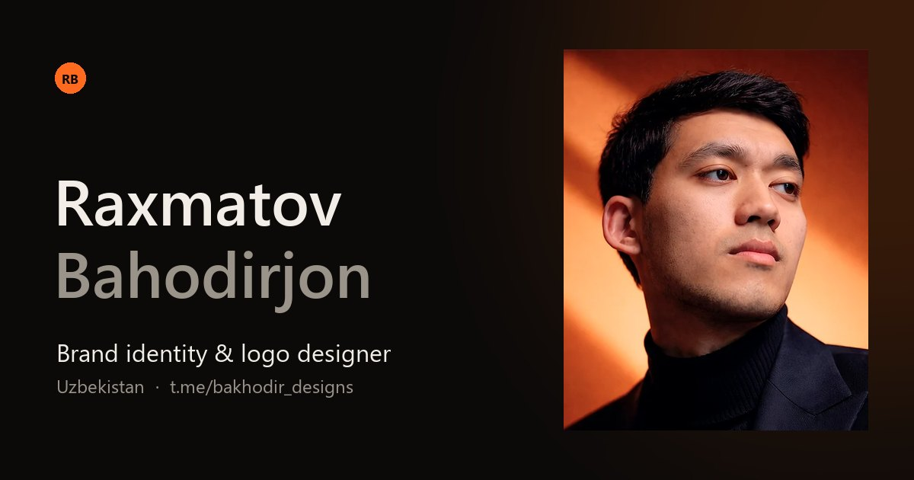

# Raxmatov Bahodirjon — Portfolio

Brend identifikatsiya va logo dizayneri Raxmatov Bahodirjonning shaxsiy portfolio sayti.
Ikki tilda (EN / UZ), animatsiyalar bilan, telefon va kompyuterga moslashgan.



## Tuzilma

```
index.html            Bosh sahifa
project.html          Loyiha sahifasi (case study), ?p=<slug> orqali ochiladi
assets/
  css/style.css       Dizayn
  js/data.js          ← Kontent: havolalar, loyihalar, statistika
  js/i18n.js          ← Interfeys matnlari (EN / UZ)
  js/main.js          Animatsiyalar va mantiq
  img/                Portret, favicon, ulashish rasmi (og.jpg)
  works/<slug>/       ← Loyiha rasmlari
  vendor/             GSAP 3.15 + Lenis 1.3 (lokal nusxa)
```

Build kerak emas — oddiy HTML/CSS/JS.

## Kontentni o‘zgartirish

**Loyiha qo‘shish.** `assets/works/` ichida loyiha uchun papka oching (masalan `assets/works/kofe-brand/`),
rasmlarni WebP formatda qo‘ying va `assets/js/data.js` dagi `PROJECTS` ro‘yxatiga yozuv qo‘shing:

```js
{
  slug: 'kofe-brand',                       // papka nomi va URL: project.html?p=kofe-brand
  title: { en: 'Kofe Brand', uz: 'Kofe Brand' },
  category: { en: 'Brand Identity', uz: 'Brend identifikatsiya' },
  year: '2026',
  client: 'Kofe LLC',
  role: { en: 'Logo, identity system', uz: 'Logo, identifikatsiya tizimi' },
  services: { en: 'Logo · Colour · Typography', uz: 'Logo · Rang · Shrift' },
  color: '#FF6A1F',                         // rasm yuklanguncha ko‘rinadigan rang
  summary:   { en: '...', uz: '...' },
  challenge: { en: '...', uz: '...' },
  solution:  { en: '...', uz: '...' },
  cover: 'assets/works/kofe-brand/1.webp',  // kartochka va muqova
  images: ['assets/works/kofe-brand/2.webp', 'assets/works/kofe-brand/3.webp']
}
```

Rasm topilmasa yoki `cover: ''` bo‘lsa, sayt avtomatik ravishda rangli namuna ko‘rsatadi.
Galereyada har 3-rasm butun kenglikda (16:9), qolganlari ikki ustunda (4:5) chiqadi.

**Havolalar va statistika** — `data.js` dagi `SITE` obyekti (Telegram, Instagram, Pinterest, email, `stats`).
`available: false` qilsangiz, "Yangi loyihalarga ochiqman" belgisi yashirinadi.

**Matnlar** — `assets/js/i18n.js`. Har bir kalit ikki tilda bor; HTML’da `data-i18n="kalit"` orqali ulanadi.

## Lokal ishga tushirish

```bash
python -m http.server 5190
# brauzerda: http://localhost:5190
```

## Joylash (GitHub Pages)

Settings → Pages → Branch: `main`, folder: `/ (root)`.
Joylagandan keyin `index.html` va `project.html` dagi `og:image` manzilini to‘liq URL’ga almashtiring
(masalan `https://<user>.github.io/Bahodir/assets/img/og.jpg`) — aks holda Telegram/Instagram preview rasmni ko‘rsatmaydi.

## Texnologiyalar

- [GSAP 3.15](https://gsap.com) — ScrollTrigger, SplitText, CustomEase (2025-yildan beri tijoriy foydalanish uchun ham bepul)
- [Lenis 1.3](https://lenis.darkroom.engineering) — silliq scroll
- Shriftlar: Syne, Manrope, Instrument Serif — `assets/fonts/` da lokal saqlangan (Google Fonts’ga bog‘liq emas)
- `prefers-reduced-motion` yoqilgan foydalanuvchilar uchun animatsiyasiz rejim
